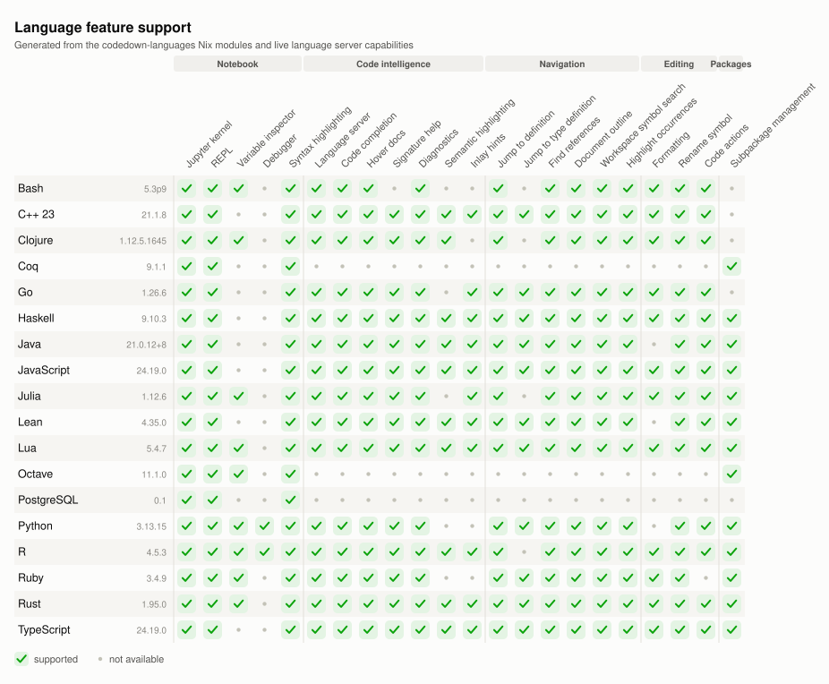

# codedown-languages

Nix modules that build reproducible language environments: one declarative config gives you
a Jupyter kernel, a language server, package management, and the notebook features that hang
off them, for every language listed below.

See the available options in [OPTIONS.md](./OPTIONS.md).

<!-- BEGIN FEATURE MATRIX -->

<picture>
  <source media="(prefers-color-scheme: dark)" srcset="docs/feature-matrix-dark.svg">
  
</picture>

<!-- END FEATURE MATRIX -->

## Exporters

| Module | Inputs | Outputs | Live rendering | Follows edits | Follows the caret, click to source |
|---|---|---|---|---|---|
| `typst` (Live Preview) | `.typ` | in-browser preview | tinymist, from the editor's buffers | yes | yes, to the character |
| `typst` | `.typ` | PDF, PNG, SVG, HTML | lsp-export-server, from the editor's buffers | no | no |
| `latex` | `.tex` | PDF | lsp-export-server, from the editor's buffers | yes | yes, to the line (SyncTeX) |
| `pandoc` | `.md` | PDF, Beamer PDF, Slidy HTML | lsp-export-server, from the editor's buffers | no | no |
| `pandoc` | `.ipynb` | PDF, Beamer PDF, Slidy HTML | re-runs on every notebook change | no | no |
| `nbconvert` | `.ipynb` | AsciiDoc, LaTeX, PDF, HTML, reStructuredText, Slides, Markdown | re-runs on every notebook change | no | no |

Following needs a map from the output back to the source. LaTeX gets one from SyncTeX and Typst from tinymist; the others have none yet.
